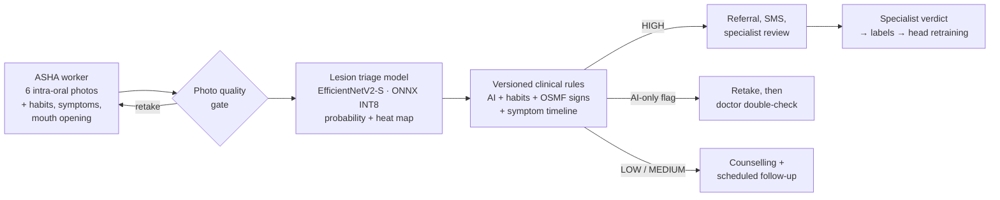

<div align="center">

# Sankalp

**AI-assisted early detection of oral cancer for frontline health workers**

[](https://github.com/Mohit-20-m/Sankalp_Oral_Cancer/actions/workflows/ci.yml)
[](https://github.com/Mohit-20-m/Sankalp_Oral_Cancer/releases)
[](LICENSE)


*Screening aid only — not a diagnostic device. A specialist confirms every high-risk result.*

</div>

---

India accounts for roughly a third of the world's oral cancer cases, and most are found late — although the
disease is usually preceded by visible, treatable changes (leukoplakia, erythroplakia, oral submucous fibrosis)
that a trained eye can spot in a photograph. **Sankalp** puts that first look in the hands of community health
workers (ASHAs): they photograph the mouth on a phone, record habits and symptoms, and the system decides —
transparently — who needs to see a specialist, then follows the patient until they do.

## How it works



The model never decides alone: its probability is one input to an auditable, versioned rule set (maker–checker
approval), alongside tobacco/areca/alcohol history, restricted mouth opening (a sign of submucous fibrosis) and how
long a patch has been present. Low-quality or unusual photos are caught at capture time and retaken instead of
being scored.

## The model

| | |
|---|---|
| Task | Intra-oral photograph → **refer** (suspicious) / **no refer** |
| Backbone | EfficientNetV2-S (ImageNet-21k), selected over ConvNeXt-Tiny and DINOv2-S |
| Data | 6,665 unique photographs from 8 public sources after duplicate grouping |
| Deployment | ONNX FP32 / INT8 on CPU, ≈ 45 ms per photo on 2 threads; calibrated probability, embedding and CAM heat map |

**Held-out test set** (346 photographs, screening threshold 0.78, 95 % bootstrap CI):

| AUC | Sensitivity | Specificity | Balanced accuracy |
|:---:|:---:|:---:|:---:|
| **0.969** (0.948–0.987) | **0.914** (0.871–0.952) | **0.950** (0.914–0.981) | **0.932** (0.905–0.959) |

5-fold cross-validation: AUC 0.972 ± 0.007. Full results, per-source breakdown and limitations are in the
[model card](models/MODEL_CARD.md).

## Repository

```
├── training/      model training pipeline (scan → dedupe → split → select → CV → train → evaluate → export)
├── notebooks/     the Kaggle notebook used to train model v1.0.0
├── models/        model card, integration contract and evaluation reports (weights via Releases)
└── scripts/       fetch-model.sh — download and verify the released model
```

## Quick start

**Get the trained model**

```bash
git clone https://github.com/Mohit-20-m/Sankalp_Oral_Cancer.git && cd Sankalp_Oral_Cancer
./scripts/fetch-model.sh          # → models/current/ (ONNX FP32 + INT8, head, contract, OOD stats)
```

**Run the reference inference on a photo** (numpy + onnxruntime only)

```bash
pip install onnxruntime numpy pillow
python training/oralscreen/inference_reference.py --artifacts models/current --image mouth.jpg
```

**Retrain from scratch** — see [`training/README.md`](training/README.md) (Kaggle, 2 × T4, about 2–4 hours).

## Roadmap

- [x] **v0.1.0** — Lesion triage model, training pipeline, model card and release artefacts
- [ ] **v0.2.0** — Backend: inference service, clinical decision engine, referral and specialist workflow, audit
- [ ] **v1.0.0** — Web app for ASHA workers and specialists: guided capture, quality gate, mouth-opening measurement

## Responsible use

Sankalp is a research prototype. The model was trained on public datasets of uncertain provenance and has **not**
been validated prospectively or on photographs taken by health workers in the field. It must not be used to rule
out disease, and every positive screen must be confirmed by a qualified clinician. See the
[limitations](models/MODEL_CARD.md#limitations).

## Acknowledgements

Training data comes from public datasets shared by their authors on Kaggle (`zaidpy/oral-cancer-dataset`,
*Mouth and Oral Diseases* / Teeth_Dataset, `salmansajid05/oral-diseases`, `mohitmural/oral-cancer-lips-and-tongue`)
and Roboflow Universe (leukoplakia and aphthous-ulcer projects). Pretrained backbones from
[timm](https://github.com/huggingface/pytorch-image-models). The images themselves are not redistributed here.

## License

Code: [MIT](LICENSE). Model weights are released for research use; the licences of the underlying datasets apply.
If you use this work, please cite it — see [`CITATION.cff`](CITATION.cff).
