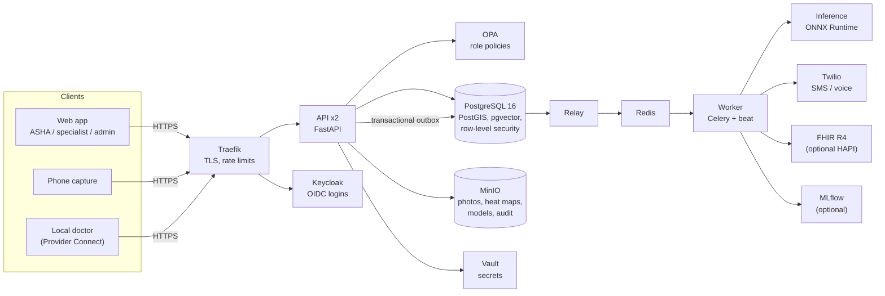

# Architecture

Arogya's backend is a set of small services started together with Docker Compose. It receives screenings from
the field, checks photo quality, runs the lesion model, applies versioned clinical rules, and then drives the care
pathway (referral, SMS, specialist review, follow-up) until the patient has been seen.

## Services

| Service | Technology | Responsibility |
|---|---|---|
| `web` | React + TypeScript, nginx | Browser app for every role; on-device photo quality checks and MediaPipe face landmarks for mouth opening |
| `traefik` | Traefik 3 | Single HTTPS entry point; routes `/api`, `/auth` and storage links; rate limits and security headers |
| `api`, `api-2` | FastAPI, SQLAlchemy | REST API (about 100 endpoints), two replicas so one can fail without downtime |
| `worker` | Celery + beat | Screening pipeline, SMS and voice, OCR, check-ins, follow-ups, retraining, drift and fairness reports, audit snapshots |
| `relay` | Python | Moves events from the PostgreSQL outbox to Redis, so no work is lost while the queue is down |
| `inference` | ONNX Runtime (INT8, CPU) | Probability, heat map, embedding and out-of-distribution distance per photo; shadow head |
| `postgres` | PostgreSQL 16 + PostGIS + pgvector + pgBackRest | System of record, nearest-facility search, similar-case search, continuous backups |
| `minio` | S3-compatible storage | Photos, heat maps, model files, write-once audit snapshots |
| `redis` | Redis 7 | Celery broker |
| `keycloak` | Keycloak 26 | Staff logins (OIDC), roles, facility claims |
| `opa` | Open Policy Agent | Role-based permissions, maker-checker rule |
| `vault` | HashiCorp Vault | Token-signing key, Twilio credentials |
| `bootstrap` | One-shot job | Migrations, buckets, secrets, model install and indexing, reference and demo data |

Optional profiles add Grafana/Prometheus/Tempo/Loki (`monitoring`), MLflow and Flower (`mlops`), a HAPI FHIR server
(`hapi`) and an ngrok tunnel for Twilio webhooks (`tunnel`).

## Web app

The React application ([`web/`](../web)) talks to the API under the same origin. Two pieces of clinical logic run
in the browser so problems are caught while the patient is still present:

- **Photo quality gate** with exactly the server's algorithm and thresholds (sharpness, exposure, glare,
  mouth-tissue colour), so a photo accepted at capture is accepted by the server.
- **Mouth-opening measurement** with MediaPipe Face Landmarker (bundled, offline): both irises (about 11.7 mm) are
  the ruler for the inner-lip distance; the worker can adjust the points, and the raw pixel readings are sent so the
  server recomputes and validates the millimetres.

Routes are guarded by role in the app and enforced again by the API.

## Screening pipeline

1. **Submit.** The client sends the screening (habits, symptoms, mouth-opening readings) and a manifest with the
   SHA-256 of every photo. The API answers with an upload plan (presigned URL or API fallback per photo).
   Re-sending the same screening returns the same plan, so unreliable networks cannot create duplicates.
2. **Upload.** Each photo is uploaded and its checksum verified. On submit, the API writes the screening and a
   `screening.process` event in the same database transaction (transactional outbox).
3. **Queue.** The relay publishes the event to Redis; a worker picks it up. Retries use exponential backoff and
   failures end in a visible dead-letter table instead of disappearing.
4. **Quality gate.** The worker re-verifies checksums and recomputes sharpness, exposure, glare and mouth-tissue
   colour on the server, so a modified client cannot bypass the gate.
5. **Inference.** Photos go to the inference service in batches. It applies the exact preprocessing of the model
   contract and returns probability, logit, a 7 x 7 heat map, the 1,280-d embedding and the Mahalanobis distance to
   the training distribution. Heat maps are rendered over the original photo and stored.
6. **Per-site score.** Each mouth site gets one score: the newest reliable photo decides; a low score on an
   unclear photo counts as low; a high score on an unclear photo is an *unreliable flag*; missing photos are
   unusable. See [clinical decision rules](clinical-decision-rules.md).
7. **Decision.** Facts (AI, habits, symptoms, mouth opening, symptom timeline) are evaluated against the active
   rule set. The most severe matching rule sets the risk level; all reasons are kept.
8. **Retake.** If the only concern is a photo, the worker asks for a retake of that site and schedules a 24-hour
   timeout that sends the case to a specialist if no retake arrives.
9. **Actions.** Referral to the nearest accepting facility (PostGIS), patient SMS, specialist task, check-in,
   follow-up, random audit sample of low-risk results, FHIR `ServiceRequest` and `DiagnosticReport`.
10. **Record.** The decision is stored with its inputs, rule-set version and hash, and model and head versions, so
    it can be replayed and verified later.

## Care continuity

- **Timeline.** Every screening, symptom report, medicine, referral, check-in reply and review is a timeline event.
  The rules read it (for example, how long a patch has been present, or whether symptoms returned).
- **Check-ins.** SMS or voice calls (Twilio) ask whether symptoms are back; a "yes" re-evaluates the patient.
- **Referrals.** Signed QR referral slips are scanned at the facility; forged tokens are rejected. Staff book or
  reschedule an appointment (date and time), which is sent to the patient by SMS. Overdue referrals trigger
  reminders.
- **Provider Connect.** A local doctor scans the patient's health card; the patient receives a one-time code and
  only after they share it can the doctor read that patient's summary.

## Learning loop (MLOps)

1. A specialist verdict becomes per-photo labels, only when the patient consented to AI training.
2. Retraining fits a new **linear head** on cached embeddings (the backbone is unchanged), so it is fast and runs on
   CPU.
3. The candidate head is scored on a fixed benchmark and runs in **shadow mode** beside the active head.
4. Promotion requires beating the champion without losing sensitivity and a clinical lead's approval. Every model
   version is registered with lineage to the dataset snapshot it was trained on, and can be rolled back; an
   automatic check rolls back if live performance degrades.

## Data model

38 tables, grouped as follows:

| Area | Tables |
|---|---|
| Reference | `villages`, `facilities`, `staff`, `consent_texts`, `system_settings` |
| Patients | `patients`, `consents`, `health_cards`, `provider_access`, `timeline_events`, `medications` |
| Screening | `screenings`, `screening_images`, `image_results`, `decisions`, `rule_sets` |
| Care pathway | `referrals`, `checkins`, `followups`, `messages`, `review_tasks`, `reviews` |
| MLOps | `labels`, `model_versions`, `training_runs`, `datasets`, `dataset_snapshots`, `lineage_edges`, `reference_cases`, `benchmark_items`, `drift_reports`, `fairness_reports` |
| Platform | `outbox`, `dead_letters`, `idempotency_keys`, `audit_log`, `audit_snapshots`, `incidents` |

Migrations are managed with Alembic (`services/app/migrations`).

## Fault tolerance

| Failure | Behaviour |
|---|---|
| Inference down | Screenings become NEEDS_REVIEW (never LOW) and are retried with backoff |
| Redis or worker down | Events wait in the PostgreSQL outbox and flow when the queue is back |
| One API replica down | Traefik routes to the healthy replica |
| A task keeps failing | Written to `dead_letters`, visible and replayable from the admin API |
| Audit log tampered with | Hash-chain verification fails and reports the first broken entry |

`ops/chaos.sh` exercises each of these scenarios against a running stack.
