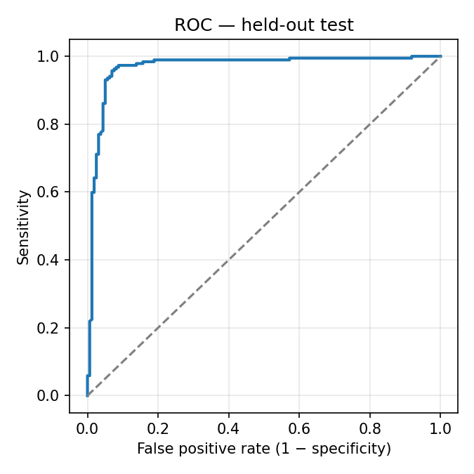
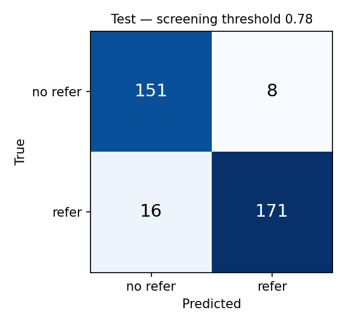
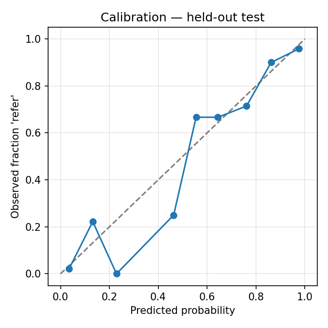

# Model card — `oralscreen-lesion-triage` v1.0.0

| | |
|---|---|
| **Task** | Binary triage of an intra-oral photograph: **refer** (suspicious — needs a specialist) vs **no_refer** |
| **Architecture** | EfficientNetV2-S (`tf_efficientnetv2_s.in21k_ft_in1k`, timm) + linear head with class-activation maps |
| **Input** | RGB, EXIF-corrected, letterboxed to 224 × 224 (pad RGB 124,116,104), ImageNet mean/std |
| **Output** | Calibrated probability of *refer*, 1280-d embedding, 7 × 7 heat map |
| **Formats** | ONNX FP32 and INT8 (full model, and backbone + `head.json`), PyTorch checkpoint |
| **Operating point** | `screening` threshold **0.780** (tuned on calibration data for ≥ 90 % sensitivity) |
| **Machine-readable** | [`v1.0.0/model_card.json`](v1.0.0/model_card.json), [`v1.0.0/model_contract.json`](v1.0.0/model_contract.json) |

> **Intended use:** decision support for frontline screening of oral potentially malignant disorders (OPMD) and
> oral cancer from smartphone photographs; flags photos that need specialist review.
> **Not intended for:** diagnosis; use without a clinician confirming results; histopathology, X-ray or non-oral images.

## Results

**Held-out test set** — 346 photographs never used for training, model selection or calibration
(187 refer / 159 no_refer), at the screening threshold, with bootstrap 95 % confidence intervals:

| Metric | Value | 95 % CI |
|---|---|---|
| AUC | **0.969** | 0.948 – 0.987 |
| Sensitivity | **0.914** | 0.871 – 0.952 |
| Specificity | **0.950** | 0.914 – 0.981 |
| Balanced accuracy | 0.932 | 0.905 – 0.959 |
| Accuracy | 0.931 | 0.902 – 0.957 |
| PPV / NPV | 0.955 / 0.904 | |
| Brier score · ECE | 0.049 · 0.027 | |

Confusion matrix: TP 171 · FN 16 · TN 151 · FP 8.

**5-fold cross-validation** of the selected backbone (development data): AUC 0.972 ± 0.007, sensitivity
0.935 ± 0.031, specificity 0.928 ± 0.048. Fold thresholds are optimised on each fold, so these numbers are
optimistic; the held-out test above is the reference estimate.

**Backbone selection** (fold 0 validation):

| Candidate | AUC | Balanced acc. | Best epoch |
|---|---|---|---|
| **EfficientNetV2-S** | **0.976** | 0.946 | 5 |
| DINOv2-S (fine-tuned) | 0.972 | 0.923 | 7 |
| ConvNeXt-Tiny | 0.970 | 0.942 | 11 |
| DINOv2-S (linear probe) | 0.934 | 0.874 | — |

**Deployment parity:** FP32 ONNX matches PyTorch to 1.4 × 10⁻⁶; INT8 changes probabilities by at most 0.0033 and
AUC by 6 × 10⁻⁵, so INT8 is the default.

  
  
  

### Per-source test results

| Source | n | Refer | Sensitivity | Specificity |
|---|---|---|---|---|
| zaidpy/oral-cancer-dataset | 191 | 97 | 0.897 | 0.968 (AUC 0.971) |
| roboflow: leukoplakia (makhluk) | 43 | 43 | 0.953 | — |
| roboflow: oral leukoplakia (oral-dquwv) | 39 | 39 | 0.923 | — |
| salmansajid05/oral-diseases | 42 | 0 | — | 0.929 |
| roboflow: aphthous ulcers (aadith) | 17 | 0 | — | 0.941 |
| roboflow: leukoplakia (oral-cancer-emoot) | 7 | 7 | 0.857 | — |
| mohitmural/oral-cancer-lips-and-tongue | 7 | 1 | 1.000 | 0.833 |

## Training data

8,346 labelled images from public datasets (Kaggle: `zaidpy/oral-cancer-dataset`, MOD *Teeth_Dataset*,
`salmansajid05/oral-diseases`, `mohitmural/oral-cancer-lips-and-tongue`; Roboflow Universe leukoplakia and
aphthous-ulcer projects). After duplicate grouping (798 exact copies, 2,735 flipped/rotated pairs, 1,982
near-duplicate pairs; 8 groups with conflicting labels removed): **6,665 unique photographs** (3,222 refer /
3,443 no_refer).

| Label | Includes |
|---|---|
| **refer** | oral cancer / OSCC, leukoplakia, erythroplakia, lichen planus, submucous fibrosis |
| **no_refer** | normal mucosa, aphthous / canker sores, cold sores, gingivostomatitis, thrush, benign ulcers |

Splits are group-aware (duplicates never cross splits) and stratified by label and source; the MOD set is used for
training only. Full details: [`v1.0.0/reports/`](v1.0.0/reports) (`scan_report.csv`, `dedupe_stats.json`,
`split_table.csv`).

## Limitations

- Trained on open datasets of uncertain provenance and licence; labels are taken as provided by the sources.
- No patient identifiers were available, so near-duplicate grouping only approximates patient-level splitting.
- **Several sources contain a single label** (e.g. all leukoplakia sets are *refer*); part of the measured
  performance may reflect source characteristics rather than the lesion itself. Only `zaidpy/oral-cancer-dataset`
  has both labels (AUC 0.971 on its own).
- **Not validated prospectively**, and not validated on photographs taken by community health workers on
  low-cost phones. Early field tests show phone photos of healthy mucosa (glare, blur, teeth in frame) can score
  high; the application therefore re-checks photo quality, asks for a retake and routes AI-only flags to a specialist.
- The model has no "not a mouth" class; an out-of-distribution statistic (Mahalanobis distance on embeddings) is
  exported to help reject unrelated images.

## Ethical considerations

The output is a **screening aid**. Every *refer* result must be reviewed by a specialist and it must never be
presented as a diagnosis. Thresholds favour sensitivity: a missed lesion costs far more than an extra review.
